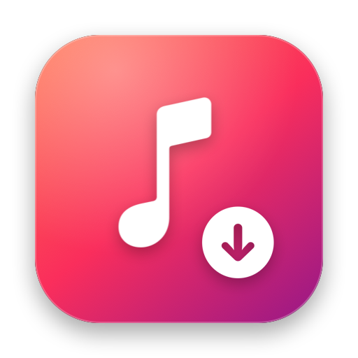
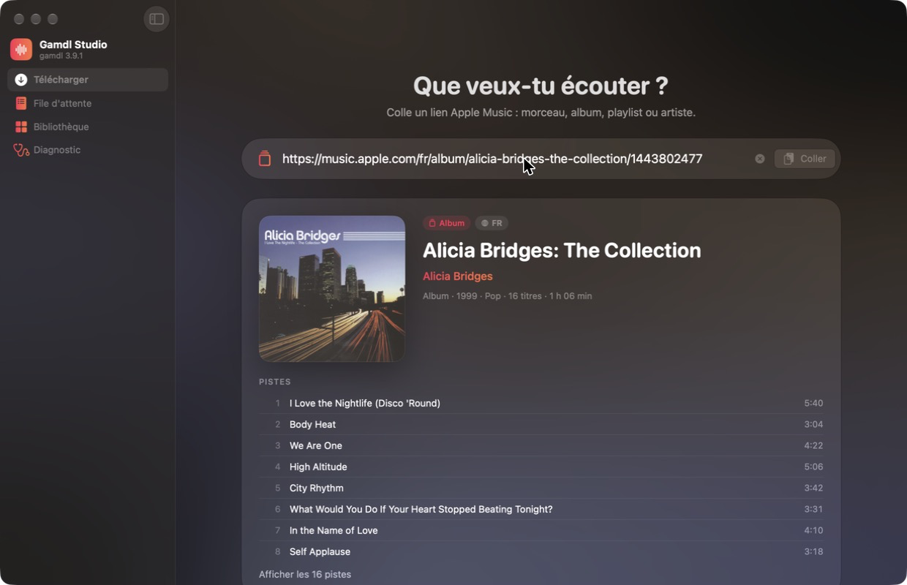

<p align="center">
  
</p>

<h1 align="center">Gamdl Studio</h1>

<p align="center">
  Une app macOS native pour <a href="https://github.com/glomatico/gamdl">gamdl</a>, l'outil de téléchargement Apple Music.
  <br>
  <a href="README.md">English version</a>
</p>

<p align="center">
  
  
  
  
</p>

<p align="center">
  
</p>

Gamdl Studio donne une interface Mac à la ligne de commande gamdl : on colle un lien, on
vérifie ce qu'il contient, on suit le téléchargement piste par piste, puis on parcourt et on
écoute ce qui a été téléchargé. gamdl tourne sur ta machine, avec ta propre session Apple
Music ; rien ne passe par un serveur tiers. L'interface existe en français et en anglais et
suit la langue de macOS.

## Fonctionnalités

- **Aperçu avant téléchargement.** Pour les morceaux, albums, artistes et clips, l'API
  publique iTunes Search fournit pochette, liste des pistes, durée et année. Pour les
  playlists, l'app lit les balises Open Graph de la page. Aucun compte n'est nécessaire.
- **File d'attente.** Progression piste par piste lue en direct dans la sortie de gamdl, débit,
  temps restant, journal brut, annulation et nouvelle tentative. Plusieurs liens collés ou
  déposés d'un coup partent tous en file.
- **Bibliothèque.** Tout le dossier de sortie, regroupé par album, avec recherche, tri,
  lecteur intégré, paroles synchronisées (LRC) et « Ouvrir dans Musique ».
- **Diagnostic.** Vérifie gamdl, ffmpeg (gamdl 3 seulement), le fichier de cookies et le dossier de sortie. Les
  cookies s'importent par glisser-déposer : seuls les cookies Apple sont conservés, avec des
  droits `600`. gamdl se met à jour depuis l'app (`pipx upgrade gamdl`).
- **Toutes les options de `gamdl rip`, dans les Réglages** (gamdl 4). Codec et codecs de secours,
  formats des paroles (fichier et intégrées), taille et format de pochette, tags à ne pas
  écrire, format de date, catégories d'artiste, listes M3U, codec, hauteur et extension des
  clips, modèles de noms de dossiers et de fichiers, morceaux et segments en parallèle, arrêt au premier
  échec, index des médias de gamdl et traces Python, plus la connexion (cookies ou wrapper),
  le storefront, la langue des métadonnées et le DRM. Un réglage laissé sur « Par défaut de
  gamdl » n'est pas passé : `~/.gamdl/config.yml` continue de s'appliquer.

<p align="center">
  
  
</p>

## Prérequis

- macOS 26 (Tahoe) ou plus récent, Mac Apple silicon ou Intel
- Un abonnement Apple Music actif
- [gamdl](https://github.com/glomatico/gamdl) 3.9 ou plus récent. gamdl 3 et gamdl 4 sont tous
  deux pris en charge : l'app lit `gamdl --version` et pilote celui qui est installé.
- [FFmpeg](https://ffmpeg.org), avec gamdl 3 seulement (gamdl 4 ne l'utilise plus)
- Un fichier `cookies.txt` exporté depuis [music.apple.com](https://music.apple.com) en étant connecté

## Installation et configuration

### 1. Installer gamdl

Avec [Homebrew](https://brew.sh) :

```bash
brew install pipx
pipx ensurepath
pipx install gamdl
```

Cela installe le gamdl actuel, en 4.x. Si tu restes sur gamdl 3, installe aussi FFmpeg
(`brew install ffmpeg`). gamdl 4 n'a plus de mode « Paroles seules » : l'option n'est proposée
qu'avec gamdl 3.

Gamdl Studio 1.1.0 et les versions précédentes ne pilotent que gamdl 3. Avec elles, installe
plutôt `pipx install 'gamdl>=3.9,<4'`, ou compile l'app depuis les sources pour gamdl 4.

Gamdl Studio cherche `gamdl` dans `~/.local/bin` (pipx), `/opt/homebrew/bin` et
`/usr/local/bin`. S'il est ailleurs, indique son chemin dans **Réglages → Avancé**.

### 2. Exporter les cookies Apple Music

1. Ouvre [music.apple.com](https://music.apple.com) et connecte-toi.
2. Installe une extension d'export :
   [Get cookies.txt LOCALLY](https://chromewebstore.google.com/detail/get-cookiestxt-locally/cclelndahbckbenkjhflpdbgdldlbecc) (Chrome)
   ou [Export Cookies](https://addons.mozilla.org/addon/export-cookies-txt) (Firefox).
3. Sur l'onglet music.apple.com, exporte les cookies au format **Netscape**.

### 3. Installer l'app

1. Télécharge `GamdlStudio-x.y.z.dmg` depuis la [dernière version](https://github.com/VitalysRDT/gamdl-studio/releases/latest).
2. Ouvre-le et glisse **Gamdl Studio** dans **Applications**. L'app est signée et notarisée.
3. Lance-la, ouvre **Diagnostic** et dépose ton `cookies.txt` dans la zone prévue.

Quand tout est au vert dans Diagnostic, colle un lien dans l'onglet **Télécharger** et appuie
sur <kbd>⌘</kbd><kbd>↩</kbd>.

### Emplacements

| Quoi | Par défaut | À changer dans |
|---|---|---|
| Téléchargements | `~/Music/Gamdl Studio` | Réglages → Général |
| Cookies | `~/Library/Application Support/Gamdl Studio/cookies.txt` | Réglages → Général |
| Fichiers temporaires | `~/Library/Caches/Gamdl Studio/temp` | Réglages → Avancé |

Les noms de dossiers et de fichiers suivent les modèles de gamdl : ta configuration gamdl
existante reste prise en compte (`~/.gamdl/config.ini` pour gamdl 3, `~/.gamdl/config.yml`
pour gamdl 4).

## Liens pris en charge

| Lien | Exemple |
|---|---|
| Morceau | `https://music.apple.com/fr/album/…/1624945511?i=1624945512` |
| Album | `https://music.apple.com/fr/album/…/1624945511` |
| Playlist | `https://music.apple.com/fr/playlist/…/pl.u-…` |
| Artiste | `https://music.apple.com/fr/artist/…/669771` |
| Clip | `https://music.apple.com/fr/music-video/…/…` |

Les playlists personnalisées (`pl.pm-…`, comme « En boucle » ou « Mix favoris ») sont refusées
par gamdl. Gamdl Studio lit leur liste de morceaux avec ta session Apple Music, via le client API
de gamdl, puis passe chaque morceau à gamdl. Les stations de radio ne sont pas téléchargeables.

## Codecs

Avec gamdl 4, tous les codecs de gamdl sont proposés, avec jusqu'à deux codecs de secours.
gamdl prend le premier codec dans lequel le morceau existe ; il ne se rabat pas quand Apple
refuse une licence.

Ce qui marche avec de simples cookies navigateur, mesuré avec gamdl 4.1.2 :

| Codec | Avec cookies | Remarque |
|---|---|---|
| AAC 256 kb/s (`aac-web`, `aac`) | Oui | Environ 260 kb/s |
| HE-AAC 64 kb/s (`aac-he-web`, `aac-he`) | Oui | Environ 70 kb/s |
| Dolby Atmos (`atmos`) | Oui | E-AC-3 5.1 à 768 kb/s, pour les morceaux mixés en Atmos |
| Binaural et mixage spatial en stéréo (`aac-binaural`, `aac-downmix`, `aac-he-binaural`, `aac-he-downmix`) | Oui | |
| ALAC (`alac`, `alac-lossless`) | Non | Apple refuse la licence : passe en mode wrapper, ci-dessous |
| ALAC Hi-Res (`alac-hires`) | Non testé | Le morceau essayé n'existe pas en hi-res ; sans doute refusé comme l'ALAC |
| Dolby Digital (`ac3`) | Non testé | Aucun morceau essayé ne le proposait |

Un morceau qui n'existe pas dans le codec choisi échoue, sauf si un codec de secours est
défini : avec l'Atmos en premier, l'AAC fait un bon secours. Pour remplacer des morceaux déjà
téléchargés dans un autre codec, active « Réécrire les fichiers existants ». gamdl 3 se limite
aux deux premiers codecs.

### ALAC : le mode wrapper

L'ALAC passe par le [wrapper-v2](https://github.com/glomatico/wrapper-v2) de gamdl, un service
qui tourne dans Docker avec un paquet Apple Music que tu fournis (3.6.0-beta, build 1109, `.apk`
ou `.apkm`). Gamdl Studio ne télécharge jamais ce paquet.

**L'assistant d'installation du wrapper** (Diagnostic, Réglages → Session, ou les notes sur
l'ALAC) l'installe sur ce Mac étape par étape, vérifie chaque étape et affiche le journal :

1. **Docker** : vérifie `docker`, les plugins Compose et Buildx et le moteur. Les outils
   manquants s'installent avec Homebrew dans le Terminal (`colima docker docker-compose
   docker-buildx`) ; un Colima arrêté est démarré (sur puce Apple, une nouvelle VM reçoit
   `--vm-type vz --vz-rosetta`).
2. **Code** : clone wrapper-v2 1.0.1 dans `~/Library/Application Support/Gamdl Studio/wrapper-v2`.
   Un dossier déjà présent n'est jamais écrasé.
3. **Paquet** : tu choisis ton propre `.apk` ou `.apkm`.
4. **Image** : lance `tools/build-docker.sh <paquet> --arch …`. x86_64 est le seul chemin validé
   de bout en bout par wrapper-v2 (émulé sur puce Apple) ; ARM64 est natif mais non vérifié.
   L'image contient des bibliothèques d'Apple : garde-la privée.
5. **Démarrage** : `docker compose up -d`, puis attend que le wrapper réponde sur `127.0.0.1:8080`.
6. **Compte Apple** : ouvre `gamdl auth` dans le Terminal. gamdl y demande ton identifiant
   Apple ; Gamdl Studio ne le voit jamais.
7. **Activation** : passe Gamdl Studio en mode wrapper sur cette adresse.

« Tout installer » enchaîne les étapes et s'arrête là où tu dois intervenir (outils, paquet,
connexion) ; l'activation vient après la connexion, car en mode wrapper tout téléchargement passe
par le wrapper. L'assistant part sur x86_64 ; passer à ARM64 propose de reconstruire l'image.

> **Pas encore testé de bout en bout ici.** wrapper-v2 vise un hôte Linux. Sur un Mac,
> l'assistant passe par la VM Linux de Colima ou de Docker Desktop, un chemin que wrapper-v2 n'a
> pas validé, et l'assistant n'a été testé qu'avec des `docker`, `git` et `colima` simulés.
 Ne lance jamais `docker compose down -v` : ça efface la session et l'identité de
l'appareil.

Choisir l'ALAC alors que le wrapper n'est pas activé ou pas prêt affiche un avertissement avant
la mise en file, avec un bouton vers l'assistant ; un lien déposé attend dans le champ au lieu
de partir directement dans la file. Le Dolby Atmos et les autres codecs spatiaux (binaural,
mixage stéréo, AC-3) ont un avertissement plus léger : ils sont passés avec le fichier de cookies
dans les mesures ci-dessus, donc l'alerte propose de télécharger avec les cookies, et
« Réglages → Session » (ou l'alerte elle-même) permet de le couper.

Un wrapper sur une autre machine marche aussi : dans **Réglages → Session**, choisis **Wrapper**
et indique son adresse. Utilise une adresse IP ou un nom en `.local` : macOS laisse l'app les
joindre en http simple, pas les autres noms. N'expose pas le wrapper sur Internet.
**Diagnostic** interroge `/info` et `/session` avec les mêmes règles que gamdl 4.1.2 (version
1.x, protocole, profil Temari) et dit ce qui ne va pas.

En mode wrapper, le fichier de cookies ne sert plus qu'aux playlists personnalisées.
**Réglages → Session** règle aussi le storefront, la langue des métadonnées, le système DRM et un
fichier d'appareil.

## Raccourcis clavier

| Raccourci | Action |
|---|---|
| <kbd>⇧</kbd><kbd>⌘</kbd><kbd>V</kbd> | Coller un lien Apple Music |
| <kbd>⌘</kbd><kbd>↩</kbd> | Lancer le téléchargement |
| <kbd>⌘</kbd><kbd>1</kbd> … <kbd>⌘</kbd><kbd>4</kbd> | Changer de section |
| <kbd>⌘</kbd><kbd>R</kbd> | Relire la bibliothèque |
| <kbd>⌘</kbd><kbd>,</kbd> | Réglages |

## Compiler depuis les sources

```bash
brew install xcodegen
git clone https://github.com/VitalysRDT/gamdl-studio.git
cd gamdl-studio
xcodegen generate
open GamdlStudio.xcodeproj
```

Il faut Xcode 26 ou plus récent. Le projet Xcode est généré depuis `project.yml` et n'est pas
versionné. L'icône est dessinée par `scripts/make-icon.swift`.

Tests : <kbd>⌘</kbd><kbd>U</kbd> dans Xcode, ou :

```bash
xcodebuild test -project GamdlStudio.xcodeproj -scheme GamdlStudio -destination 'platform=macOS'
```

Les tests (Swift Testing) ne contactent jamais Apple Music. Les tests d'intégration font
tourner la vraie file de téléchargement contre un faux script `gamdl` qui rejoue une sortie
de gamdl enregistrée, et lancent les scripts Python de l'app (`gamdl_bridge.py`,
`resolve_playlist.py`) contre des paquets `gamdl` factices, avec le Python 3 présent sur le
Mac. Ces tests-là sont ignorés s'il n'y en a pas.

Pour produire un DMG signé et notarisé, voir [`scripts/release.sh`](scripts/release.sh).

## Fonctionnement

- L'app lance gamdl comme processus enfant, avec les options qu'on lui passerait à la main, et
  lit sa sortie ligne par ligne. Chaque journal propose de copier la commande exacte.
- gamdl 4 a remplacé la commande unique de gamdl 3 par des sous-commandes et renommé la plupart
  des options : la commande est donc construite selon la version majeure installée (lue avec
  `gamdl --version`, mise en cache par exécutable) :
  - gamdl 3 : `gamdl --cookies-path … --output-path … --song-codec-priority … URL`
  - gamdl 4 : `gamdl rip --auth-mode cookies --cookies-path … --output-dir … URL`, avec
    `--concurrent-downloads` (1 par défaut, jusqu'à 4 dans Réglages → Avancé) et `--no-progress`.
    Avec plusieurs morceaux à la fois, le pont rapporte chaque issue avec le numéro du morceau :
    chacun se termine sur sa propre ligne, même si deux portent le même titre.
- Une app lancée depuis le Finder n'hérite pas du `PATH` du terminal : gamdl et ffmpeg sont
  donc localisés explicitement.
- gamdl tourne avec `PYTHONUNBUFFERED=1` pour une progression en temps réel, et stdin fermé :
  une question interactive échoue au lieu de bloquer.
- Avec gamdl 3, la progression se base sur le compteur de fragments HLS de yt-dlp plutôt que
  sur son pourcentage, qui recule à chaque révision de l'estimation de taille.
- gamdl 4 dessine sa progression avec un affichage éphémère qui n'écrit rien dans un pipe.
  L'app le lance donc via `GamdlStudio/Resources/gamdl_bridge.py`, avec le Python de gamdl :
  le script se branche sur cet affichage, écrit chaque début de morceau, transfert et échec en
  JSON, puis passe les arguments au point d'entrée de gamdl. Si un gamdl ultérieur renomme cet
  affichage, gamdl tourne tel quel et l'app se rabat sur les lignes que gamdl écrit à la fin de
  chaque morceau.
- L'annulation envoie `SIGINT` à gamdl et à ses processus enfants, puis `SIGTERM` et `SIGKILL`
  s'ils tournent encore.
- Les playlists personnalisées sont dépliées par `GamdlStudio/Resources/resolve_playlist.py`,
  lancé avec l'interpréteur Python de ton installation de gamdl : l'authentification reste
  l'affaire de gamdl.

## Crédits

- [**gamdl**](https://github.com/glomatico/gamdl), par [glomatico](https://github.com/glomatico),
  fait tout le travail de téléchargement, de déchiffrement et de tags. Gamdl Studio n'en est
  que l'interface : les problèmes de téléchargement sont à signaler à gamdl.
- [FFmpeg](https://ffmpeg.org) et [yt-dlp](https://github.com/yt-dlp/yt-dlp), utilisés par gamdl 3.

## Avertissement

Gamdl Studio est un projet indépendant, sans lien avec Apple Inc. ni avec le projet gamdl, qui
ne l'approuvent ni ne le soutiennent. Apple Music est une marque d'Apple Inc.

À utiliser uniquement avec ton propre abonnement Apple Music, pour un usage personnel, dans le
respect des conditions d'utilisation d'Apple et du droit d'auteur de ton pays. Ne redistribue
pas les contenus téléchargés.

## Licence

[MIT](LICENSE)
