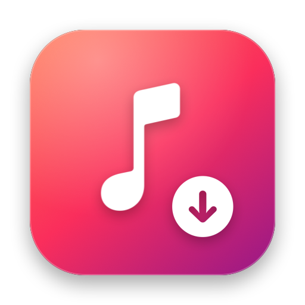
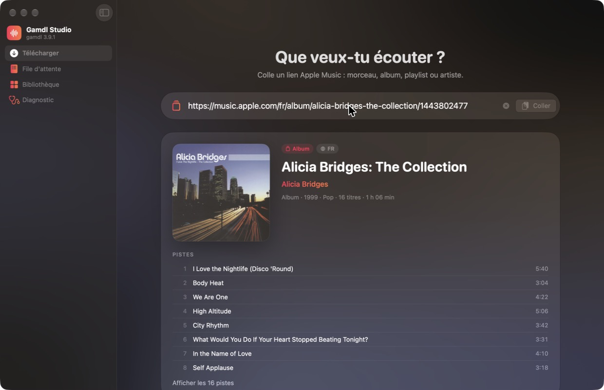
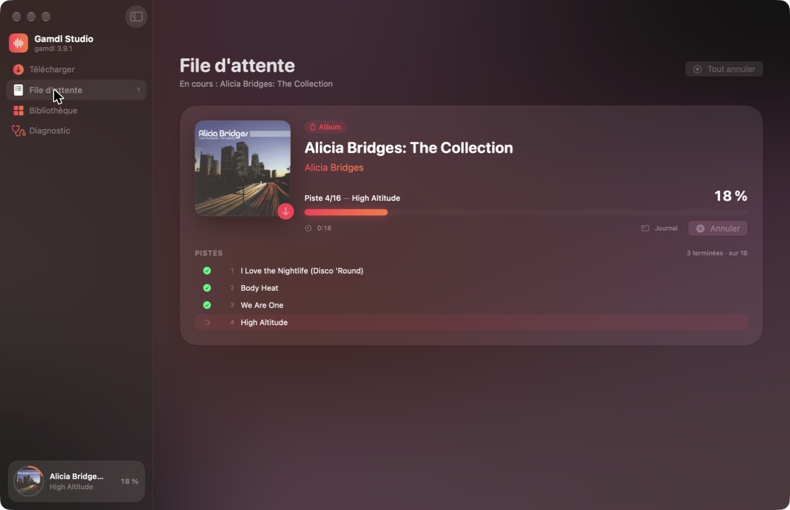
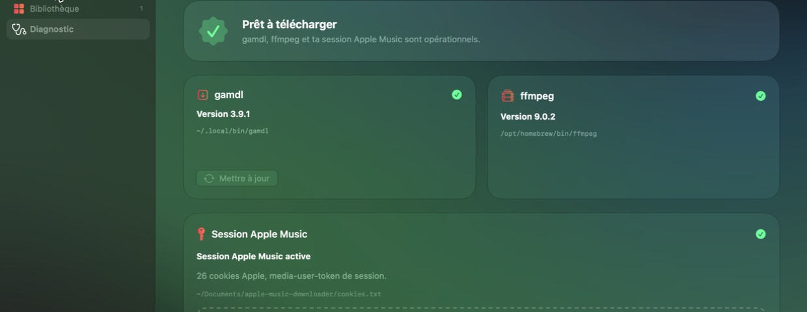

<p align="center">
  
</p>

<h1 align="center">Gamdl Studio</h1>

<p align="center">
  A native macOS app for <a href="https://github.com/glomatico/gamdl">gamdl</a>, the Apple Music downloader.
  <br>
  <a href="README.fr.md">Version française</a>
</p>

<p align="center">
  
  
  
  
</p>

<p align="center">
  
</p>

Gamdl Studio wraps the gamdl command line in a Mac interface: paste a link, check what it
points to, follow the download track by track, then browse and play what you downloaded.
It runs gamdl on your machine with your own Apple Music session; nothing goes through a
third-party server. The interface is available in English and French and follows your
macOS language.

## Features

- **Link preview before downloading.** Songs, albums, artists and music videos are looked up
  through the public iTunes Search API (artwork, tracklist, duration, release year).
  Playlists fall back to the page's Open Graph tags. No account is needed for the preview.
- **Download queue.** Live per-track progress parsed from gamdl's output, speed and remaining
  time, raw log, cancel and retry. Several links pasted or dropped at once are all queued.
- **Library.** Everything in the output folder, grouped by album, with search, sorting,
  a built-in player, synced lyrics (LRC) and "Open in Music".
- **Diagnostics.** Checks gamdl, ffmpeg (gamdl 3 only), the cookies file and the output folder. Cookies can be
  imported by drag and drop: only Apple cookies are kept, and the file is saved with `600`
  permissions. gamdl can be updated from the app (`pipx upgrade gamdl`).
- **Every `gamdl rip` option, in Settings** (gamdl 4). Codec and fallbacks, lyrics file and
  embedded formats, artwork size and format, tags to leave out, date format, artist
  categories, M3U playlists, music video codec, height and container, folder and file name
  templates, tracks and segments in parallel, fail-fast, gamdl's media index and tracebacks, plus sign-in
  (cookies or wrapper), storefront, metadata language and DRM. A setting left
  on "gamdl default" isn't passed, so `~/.gamdl/config.yml` keeps applying.

<p align="center">
  
  
</p>

## Requirements

- macOS 26 (Tahoe) or later, Apple silicon or Intel
- An active Apple Music subscription
- [gamdl](https://github.com/glomatico/gamdl) 3.9 or later. gamdl 3 and gamdl 4 are both
  supported; the app reads `gamdl --version` and drives whichever is installed.
- [FFmpeg](https://ffmpeg.org), with gamdl 3 only (gamdl 4 no longer uses it)
- A `cookies.txt` exported from [music.apple.com](https://music.apple.com) while signed in

## Setup

### 1. Install gamdl

With [Homebrew](https://brew.sh):

```bash
brew install pipx
pipx ensurepath
pipx install gamdl
```

This installs the current gamdl, 4.x. If you stay on gamdl 3, also install FFmpeg
(`brew install ffmpeg`). gamdl 4 has no "lyrics only" mode: that option is only offered
with gamdl 3.

Gamdl Studio 1.1.0 and earlier only drive gamdl 3. With those versions, install
`pipx install 'gamdl>=3.9,<4'` instead, or build the app from source for gamdl 4.

Gamdl Studio looks for `gamdl` in `~/.local/bin` (pipx), `/opt/homebrew/bin` and
`/usr/local/bin`. If yours lives elsewhere, set its path in **Settings → Advanced**.

### 2. Export your Apple Music cookies

1. Open [music.apple.com](https://music.apple.com) and sign in.
2. Install a cookie exporter:
   [Get cookies.txt LOCALLY](https://chromewebstore.google.com/detail/get-cookiestxt-locally/cclelndahbckbenkjhflpdbgdldlbecc) (Chrome)
   or [Export Cookies](https://addons.mozilla.org/addon/export-cookies-txt) (Firefox).
3. On the music.apple.com tab, export the cookies in **Netscape** format.

### 3. Install the app

1. Download `GamdlStudio-x.y.z.dmg` from the [latest release](https://github.com/VitalysRDT/gamdl-studio/releases/latest).
2. Open it and drag **Gamdl Studio** to **Applications**. The app is signed and notarized.
3. Launch it, open **Diagnostics**, and drop your `cookies.txt` onto the drop zone.

When the Diagnostics tab shows everything green, paste a link in the **Download** tab and
press <kbd>⌘</kbd><kbd>↩</kbd>.

### Where files go

| What | Default location | Change it in |
|---|---|---|
| Downloads | `~/Music/Gamdl Studio` | Settings → General |
| Cookies | `~/Library/Application Support/Gamdl Studio/cookies.txt` | Settings → General |
| Temporary files | `~/Library/Caches/Gamdl Studio/temp` | Settings → Advanced |

Folder and file names follow gamdl's own templates, so the gamdl configuration you already
use still applies (`~/.gamdl/config.ini` for gamdl 3, `~/.gamdl/config.yml` for gamdl 4).

## Supported links

| Link | Example |
|---|---|
| Song | `https://music.apple.com/us/album/…/1624945511?i=1624945512` |
| Album | `https://music.apple.com/us/album/…/1624945511` |
| Playlist | `https://music.apple.com/us/playlist/…/pl.u-…` |
| Artist | `https://music.apple.com/us/artist/…/669771` |
| Music video | `https://music.apple.com/us/music-video/…/…` |

Personalized playlists (`pl.pm-…`, such as Replay or Favorites Mix) are not accepted by gamdl's
URL parser. Gamdl Studio reads their track list through your Apple Music session, using gamdl's
own API client, and hands gamdl one song link per track. Radio stations cannot be downloaded.

## Codecs

With gamdl 4, every codec gamdl knows can be picked, with up to two fallbacks. gamdl takes the
first codec a song exists in; it doesn't fall back when Apple refuses a license.

What works with browser cookies alone, measured with gamdl 4.1.2:

| Codec | With cookies | Note |
|---|---|---|
| AAC 256 kb/s (`aac-web`, `aac`) | Yes | About 260 kb/s |
| HE-AAC 64 kb/s (`aac-he-web`, `aac-he`) | Yes | About 70 kb/s |
| Dolby Atmos (`atmos`) | Yes | E-AC-3 5.1 at 768 kb/s, for songs mixed in Atmos |
| Binaural and spatial downmix (`aac-binaural`, `aac-downmix`, `aac-he-binaural`, `aac-he-downmix`) | Yes | |
| ALAC (`alac`, `alac-lossless`) | No | Apple refuses the license: use wrapper mode, below |
| ALAC Hi-Res (`alac-hires`) | Untested | The song tried has no hi-res version; most likely refused like ALAC |
| Dolby Digital (`ac3`) | Untested | No song tried offered it |

A song that doesn't exist in the chosen codec fails unless a fallback is set; with Atmos first,
AAC is a good fallback. To replace songs already downloaded in another codec, turn on
"Overwrite existing files". gamdl 3 is limited to the first two codecs.

### ALAC: wrapper mode

ALAC takes gamdl's [wrapper-v2](https://github.com/glomatico/wrapper-v2), a service that runs in
Docker with an Apple Music package you supply (3.6.0-beta, build 1109, `.apk` or `.apkm`).
Gamdl Studio never downloads that package.

**The wrapper installation assistant** (Diagnostics, Settings → Session, or the ALAC notes)
installs it on this Mac step by step, checks each step, and shows the log:

1. **Docker**: checks `docker`, the Compose and Buildx plugins and the engine. Missing tools are
   installed with Homebrew in Terminal (`colima docker docker-compose docker-buildx`); a stopped
   Colima is started (on Apple silicon, a new VM gets `--vm-type vz --vz-rosetta`).
2. **Source**: clones wrapper-v2 1.0.1 into `~/Library/Application Support/Gamdl Studio/wrapper-v2`.
   A folder already there is never overwritten.
3. **Package**: you choose your own `.apk` or `.apkm`.
4. **Image**: runs `tools/build-docker.sh <package> --arch …`. x86_64 is the only path wrapper-v2
   validated end to end (emulated on Apple silicon); ARM64 is native but unverified. The image
   holds Apple's libraries: keep it private.
5. **Start**: `docker compose up -d`, then waits for the wrapper to answer on `127.0.0.1:8080`.
6. **Apple Account**: opens `gamdl auth` in Terminal. gamdl asks for your Apple ID there;
   Gamdl Studio never sees it.
7. **Activation**: switches Gamdl Studio to wrapper mode on that address.

"Install All" runs the steps in order and stops where you're needed (tools, package, sign-in);
activation comes after the sign-in, because in wrapper mode every download goes through the
wrapper. The assistant defaults to x86_64; switching to ARM64 offers a rebuild.

> **Not yet run end to end here.** wrapper-v2 targets a Linux host. On a Mac the assistant uses
> the Linux VM of Colima or Docker Desktop, a path wrapper-v2 hasn't validated, and this assistant
> has only been tested against simulated `docker`, `git` and `colima`.

Never run `docker compose down -v`: it erases the session and the device identity.

Choosing ALAC while the wrapper isn't active or ready brings up a warning before the download
is queued, with a button to the assistant; a dropped link waits in the link field instead of
going straight to the queue. Dolby Atmos and the other spatial codecs (binaural, downmix, AC-3)
get a lighter warning: they downloaded with the cookies file in the measurements above, so the
alert offers to download with cookies, and "Settings → Session" (or the alert itself) turns it
off.

A wrapper on another machine also works: in **Settings → Session**, choose **Wrapper** and enter
its address. Use an IP address or a `.local` name: macOS lets the app reach those over plain
http, not other host names. Don't expose the wrapper to the Internet. **Diagnostics** checks its
`/info` and `/session` with the same rules as gamdl 4.1.2 (version 1.x, protocol, Temari
profile) and says what is wrong.

In wrapper mode the cookies file is only used for personalized playlists. **Settings → Session**
also sets the storefront, the metadata language, the DRM system and a device file.

## Keyboard shortcuts

| Shortcut | Action |
|---|---|
| <kbd>⇧</kbd><kbd>⌘</kbd><kbd>V</kbd> | Paste an Apple Music link |
| <kbd>⌘</kbd><kbd>↩</kbd> | Start the download |
| <kbd>⌘</kbd><kbd>1</kbd> … <kbd>⌘</kbd><kbd>4</kbd> | Switch section |
| <kbd>⌘</kbd><kbd>R</kbd> | Rescan the library |
| <kbd>⌘</kbd><kbd>,</kbd> | Settings |

## Building from source

```bash
brew install xcodegen
git clone https://github.com/VitalysRDT/gamdl-studio.git
cd gamdl-studio
xcodegen generate
open GamdlStudio.xcodeproj
```

Requires Xcode 26 or later. The Xcode project is generated from `project.yml` and is not
checked in. The app icon is drawn by `scripts/make-icon.swift`.

Run the tests with <kbd>⌘</kbd><kbd>U</kbd> in Xcode or:

```bash
xcodebuild test -project GamdlStudio.xcodeproj -scheme GamdlStudio -destination 'platform=macOS'
```

The suite (Swift Testing) never contacts Apple Music. Integration tests drive the real
download queue against a fake `gamdl` script that replays recorded gamdl output, and run the
app's Python scripts (`gamdl_bridge.py`, `resolve_playlist.py`) against stub `gamdl` packages
with the Python 3 found on the Mac. Those tests are skipped when there is none.

To produce a signed, notarized DMG, see [`scripts/release.sh`](scripts/release.sh).

## How it works

- The app runs gamdl as a child process with the same options you would pass by hand and reads
  its output line by line. A copyable command line is available in each job's log.
- gamdl 4 replaced gamdl 3's single command with subcommands and renamed most options, so the
  command line is built for the installed major version (read from `gamdl --version`, cached
  per executable):
  - gamdl 3: `gamdl --cookies-path … --output-path … --song-codec-priority … URL`
  - gamdl 4: `gamdl rip --auth-mode cookies --cookies-path … --output-dir … URL`, plus
    `--concurrent-downloads` (1 by default, up to 4 in Settings → Advanced) and `--no-progress`.
    With several tracks at once, the bridge reports each outcome with the track's number, so
    every track ends on its own row, even when two share a title.
- Apps launched from the Finder do not inherit your shell's `PATH`, so gamdl and ffmpeg are
  located explicitly and passed an explicit `PATH`.
- gamdl runs with `PYTHONUNBUFFERED=1` so progress arrives in real time, and with stdin closed
  so an interactive prompt fails instead of hanging.
- With gamdl 3, progress is computed from yt-dlp's HLS fragment counter rather than its
  percentage, which moves backwards whenever the size estimate is revised.
- gamdl 4 draws its progress with a transient display that prints nothing into a pipe. The app
  therefore runs it through `GamdlStudio/Resources/gamdl_bridge.py`, with gamdl's own Python:
  the script hooks that display, prints each track start, transfer and failure as a JSON line,
  then hands the arguments to gamdl's entry point. If a later gamdl renames the display, gamdl
  runs untouched and the app falls back to the lines gamdl prints when a track is done.
- Cancelling sends `SIGINT` to gamdl and its child processes, then `SIGTERM` and `SIGKILL` if
  they are still running.
- Personalized playlists are expanded by `GamdlStudio/Resources/resolve_playlist.py`, run with
  the Python interpreter of your gamdl install, so authentication stays gamdl's job.

## Credits

- [**gamdl**](https://github.com/glomatico/gamdl) by [glomatico](https://github.com/glomatico)
  does all the downloading, decrypting and tagging. Gamdl Studio is only an interface for it.
  Please report download issues to gamdl.
- [FFmpeg](https://ffmpeg.org) and [yt-dlp](https://github.com/yt-dlp/yt-dlp), used by gamdl 3.

## Disclaimer

Gamdl Studio is an independent project. It is not affiliated with, endorsed by or sponsored by
Apple Inc. or the gamdl project. Apple Music is a trademark of Apple Inc.

Use it only with your own Apple Music subscription, for personal use, and in accordance with
Apple's terms of service and the copyright law of your country. Do not redistribute
downloaded content.

## License

[MIT](LICENSE)
