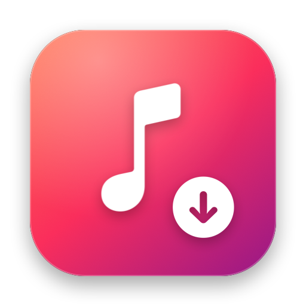
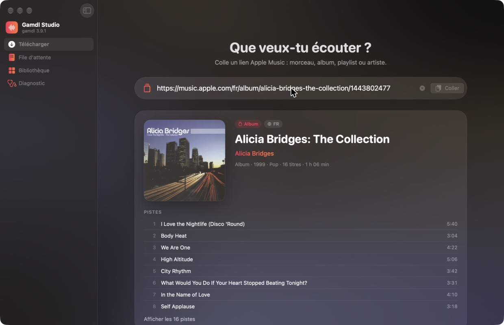
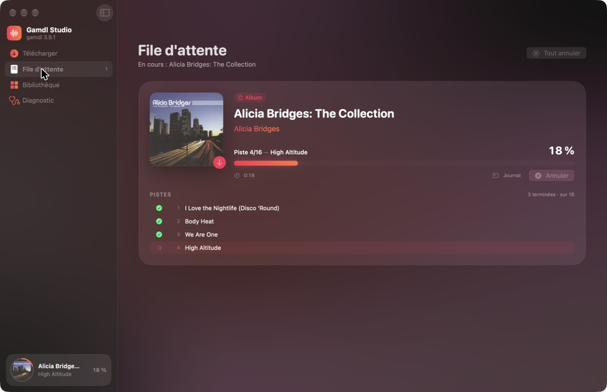
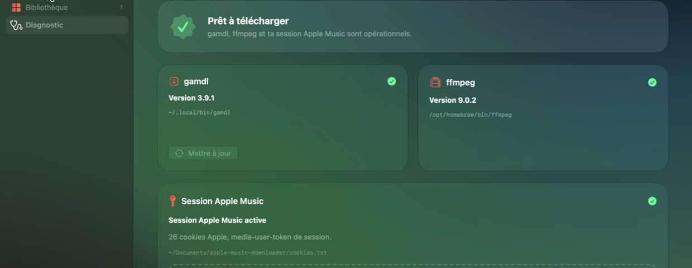

<p align="center">
  
</p>

<h1 align="center">Gamdl Studio</h1>

<p align="center">
  A native macOS app for <a href="https://github.com/glomatico/gamdl">gamdl</a>, the Apple Music downloader.
  <br>
  <a href="README.fr.md">Version française</a>
</p>

<p align="center">
  
  
  
  
</p>

<p align="center">
  
</p>

Gamdl Studio wraps the gamdl command line in a Mac interface: paste a link, check what it
points to, follow the download track by track, then browse and play what you downloaded.
It runs gamdl on your machine with your own Apple Music session; nothing goes through a
third-party server. The interface is available in English and French and follows your
macOS language.

## Features

- **Link preview before downloading.** Songs, albums, artists and music videos are looked up
  through the public iTunes Search API (artwork, tracklist, duration, release year).
  Playlists fall back to the page's Open Graph tags. No account is needed for the preview.
- **Download queue.** Live per-track progress parsed from gamdl's output, speed and remaining
  time, raw log, cancel and retry. Several links pasted or dropped at once are all queued.
- **Library.** Everything in the output folder, grouped by album, with search, sorting,
  a built-in player, synced lyrics (LRC) and "Open in Music".
- **Diagnostics.** Checks gamdl, ffmpeg, the cookies file and the output folder. Cookies can be
  imported by drag and drop: only Apple cookies are kept, and the file is saved with `600`
  permissions. gamdl can be updated from the app (`pipx upgrade gamdl`).
- **Download options.** Codec, synced lyrics format, artwork size, `Cover.jpg`, overwrite, and
  what to fetch from an artist page.

<p align="center">
  
  
</p>

## Requirements

- macOS 26 (Tahoe) or later, Apple silicon or Intel
- An active Apple Music subscription
- [gamdl](https://github.com/glomatico/gamdl) 3.9 or later and [FFmpeg](https://ffmpeg.org)
- A `cookies.txt` exported from [music.apple.com](https://music.apple.com) while signed in

## Setup

### 1. Install gamdl and FFmpeg

With [Homebrew](https://brew.sh):

```bash
brew install pipx ffmpeg
pipx ensurepath
pipx install gamdl
```

Gamdl Studio looks for `gamdl` in `~/.local/bin` (pipx), `/opt/homebrew/bin` and
`/usr/local/bin`. If yours lives elsewhere, set its path in **Settings → Advanced**.

### 2. Export your Apple Music cookies

1. Open [music.apple.com](https://music.apple.com) and sign in.
2. Install a cookie exporter:
   [Get cookies.txt LOCALLY](https://chromewebstore.google.com/detail/get-cookiestxt-locally/cclelndahbckbenkjhflpdbgdldlbecc) (Chrome)
   or [Export Cookies](https://addons.mozilla.org/addon/export-cookies-txt) (Firefox).
3. On the music.apple.com tab, export the cookies in **Netscape** format.

### 3. Install the app

1. Download `GamdlStudio-x.y.z.dmg` from the [latest release](https://github.com/VitalysRDT/gamdl-studio/releases/latest).
2. Open it and drag **Gamdl Studio** to **Applications**. The app is signed and notarized.
3. Launch it, open **Diagnostics**, and drop your `cookies.txt` onto the drop zone.

When the Diagnostics tab shows everything green, paste a link in the **Download** tab and
press <kbd>⌘</kbd><kbd>↩</kbd>.

### Where files go

| What | Default location | Change it in |
|---|---|---|
| Downloads | `~/Music/Gamdl Studio` | Settings → General |
| Cookies | `~/Library/Application Support/Gamdl Studio/cookies.txt` | Settings → General |
| Temporary files | `~/Library/Caches/Gamdl Studio/temp` | Settings → Advanced |

Folder and file names follow gamdl's own templates, so any `~/.gamdl/config.ini` you already
use still applies.

## Supported links

| Link | Example |
|---|---|
| Song | `https://music.apple.com/us/album/…/1624945511?i=1624945512` |
| Album | `https://music.apple.com/us/album/…/1624945511` |
| Playlist | `https://music.apple.com/us/playlist/…/pl.u-…` |
| Artist | `https://music.apple.com/us/artist/…/669771` |
| Music video | `https://music.apple.com/us/music-video/…/…` |

Personalized playlists (`pl.pm-…`, such as Replay or Favorites Mix) are not accepted by gamdl's
URL parser. Gamdl Studio reads their track list through your Apple Music session, using gamdl's
own API client, and hands gamdl one song link per track. Radio stations cannot be downloaded.

## Codecs

Gamdl Studio offers the two codecs gamdl can fetch with browser cookies alone:
**AAC 256 kb/s** (`aac-web`) and **HE-AAC 64 kb/s** (`aac-he-web`). Lossless ALAC and Dolby Atmos
require gamdl's [wrapper](https://github.com/glomatico/wrapper-v2), which the app does not drive.

## Keyboard shortcuts

| Shortcut | Action |
|---|---|
| <kbd>⇧</kbd><kbd>⌘</kbd><kbd>V</kbd> | Paste an Apple Music link |
| <kbd>⌘</kbd><kbd>↩</kbd> | Start the download |
| <kbd>⌘</kbd><kbd>1</kbd> … <kbd>⌘</kbd><kbd>4</kbd> | Switch section |
| <kbd>⌘</kbd><kbd>R</kbd> | Rescan the library |
| <kbd>⌘</kbd><kbd>,</kbd> | Settings |

## Building from source

```bash
brew install xcodegen
git clone https://github.com/VitalysRDT/gamdl-studio.git
cd gamdl-studio
xcodegen generate
open GamdlStudio.xcodeproj
```

Requires Xcode 26 or later. The Xcode project is generated from `project.yml` and is not
checked in. The app icon is drawn by `scripts/make-icon.swift`.

Run the tests with <kbd>⌘</kbd><kbd>U</kbd> in Xcode or:

```bash
xcodebuild test -project GamdlStudio.xcodeproj -scheme GamdlStudio -destination 'platform=macOS'
```

The suite (Swift Testing) never contacts Apple Music. Integration tests drive the real
download queue against a fake `gamdl` script that replays recorded gamdl output.

To produce a signed, notarized DMG, see [`scripts/release.sh`](scripts/release.sh).

## How it works

- The app runs gamdl as a child process with the same options you would pass by hand
  (`--cookies-path`, `--output-path`, `--song-codec-priority`, …) and reads its output line by
  line. A copyable command line is available in each job's log.
- Apps launched from the Finder do not inherit your shell's `PATH`, so gamdl and ffmpeg are
  located explicitly and passed an explicit `PATH`.
- gamdl runs with `PYTHONUNBUFFERED=1` so progress arrives in real time, and with stdin closed
  so an interactive prompt fails instead of hanging.
- Progress is computed from yt-dlp's HLS fragment counter rather than its percentage, which
  moves backwards whenever the size estimate is revised.
- Cancelling sends `SIGINT` to gamdl and its child processes, then `SIGTERM` and `SIGKILL` if
  they are still running.
- Personalized playlists are expanded by `GamdlStudio/Resources/resolve_playlist.py`, run with
  the Python interpreter of your gamdl install, so authentication stays gamdl's job.

## Credits

- [**gamdl**](https://github.com/glomatico/gamdl) by [glomatico](https://github.com/glomatico)
  does all the downloading, decrypting and tagging. Gamdl Studio is only an interface for it.
  Please report download issues to gamdl.
- [FFmpeg](https://ffmpeg.org) and [yt-dlp](https://github.com/yt-dlp/yt-dlp), used by gamdl.

## Disclaimer

Gamdl Studio is an independent project. It is not affiliated with, endorsed by or sponsored by
Apple Inc. or the gamdl project. Apple Music is a trademark of Apple Inc.

Use it only with your own Apple Music subscription, for personal use, and in accordance with
Apple's terms of service and the copyright law of your country. Do not redistribute
downloaded content.

## License

[MIT](LICENSE)
